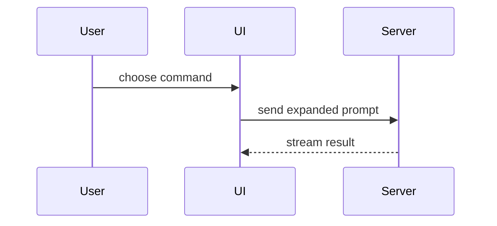

<!--
  Started from `pr` in mattpocock/skills (skills/engineering/pr), merged with the body rules that
  used to live in docs/agents/pull-requests.md. That doc keeps the title rule, UI evidence
  mechanics and babysitting; the body is defined here.
-->

# PR body

PRs are squash-merged: the title becomes the commit subject (`pnpm check:pr-title`, see
[pull-requests.md](../../../docs/agents/pull-requests.md)), and the issue is the record of why.
The body is for the reviewer, who has the diff open. Write it in this template and stop:

```markdown
<anything the reviewer must do or decide, first; omit when there is nothing>

## Summary

<the problem in one or two sentences, then the fix: a short paragraph or a few bullets, and a
picture when the point is structure or order>

## Evidence

- **Before:** <screenshot / failing test run / output>
  **After:** <screenshot / passing test run / output>

## Merge Danger

**Door:** <one-way or two-way>

<optional: what a revert does not undo>

**Blast Radius:** <one or two words>

<optional: what breaks, and for whom, if the change is wrong>

## Review

Tier: <tier>, reviewed <short sha>

- <axis> (<model>): <findings, fixed, declined; how many the other correctness reviewer also found>

Closes #N
```

## Rules

- **Do not restate the issue.** The investigation, the alternatives and the domain reasoning live
  in the issue or an ADR. Link them; a reviewer who wants them follows the link.
- **Anything the reviewer must do or decide goes first**, above `## Summary`: a migration to run,
  a setting to change, a call that is theirs.
- **One concern per PR.** If the description needs the word "also", it is two PRs. A PRD PR is
  the deliberate exception (below).
- **`Closes #N`** closes the issue on merge
  ([issue-tracker.md](../../../docs/agents/issue-tracker.md#closing-an-issue)).
- English, per [coding-standards.md](../../../docs/agents/coding-standards.md#code-language);
  Spanish only inside backticks, as data. Use the domain's terms from `GLOSSARY.md`.
- Skip preambles and keep prose brief. Name a symbol or a file only when the reviewer would not
  find it alone.

## Summary

Say what was wrong or missing, as the user or the maintainer would see it, then what changed and,
when it is not obvious from the diff, why this way. A bullet that runs past three lines is a sign
that a picture would have been shorter.

When the point of the fix is structure or order, pick the smallest view that makes it clear:

- Logic or an algorithm as pseudocode:

```text
on(save)
  if content is unchanged
    return cached result
  write new content
  return fresh result
```

- Runtime control flow as a call tree:

```text
submitForm
  createSession
    persistPrompt
    launchAgent
  navigateToSession
```

- UI structure as a component tree, including state and module boundaries that matter:

```text
<SessionPage> (app/features/example/view.tsx)
  useSessionEvents()
  <SessionToolbar>
    <RunSkillButton> (app/components/ui)
```

- File responsibility or a broad refactor as a shallow file tree:

```text
app/lib/
├── commands/       # parses user actions
├── sessions/       # owns session state
└── transport/      # sends API requests
```

- Component interaction, control flow, or data flow with Mermaid:



- `diff` when the point is what changes and the surrounding shape already exists. Match the diff
  shape to the topic:

```diff
 on(save)
-  write content
+  if content is unchanged
+    return cached result
+  write new content
+  invalidate cache
```

- The whole block when most of it is new, when omitted context would hide ownership or order, or
  when the reviewer needs a copyable target shape.

Place each visual next to the sentence it supports, keep only the calls, files, props, states and
boundaries the point needs, and use one, rarely two.

## Evidence

Concrete evidence that the change works, as a before and after.

- **Screenshots** are the best evidence when the change is visual: a PR that changes what a screen
  looks like carries before and after images, and a change to motion or interaction a short GIF.
  They are captured against seed data and attached with `pnpm pr:evidence`, which prints the
  Before/After table to paste here
  ([UI evidence](../../../docs/agents/pull-requests.md#ui-evidence)).
- **A test** is the next best: name it and say it failed without the change. A list of green
  commands is a claim, not a before and after.
- Say what was checked by hand, and what was not. Never claim a command that was not run; if
  nothing beyond CI was, say so in one line instead of the before/after pair.

## Merge Danger

**Door** says whether a revert takes the merge back (**two-way**) or something survives it
(**one-way**). It tells the reviewer how slowly to read. These are always one-way doors on this
repo, however small the diff:

- A migration that drops or rewrites data: the contract step of expand and contract
  ([migrations.md](../../../docs/db/migrations.md#the-exception-mechanism)), a backfill that
  overwrites, or anything the previous container cannot run against during the deploy.
- Anything that reaches outside the app: an email sent through Resend, a message, a file someone
  downloads. A revert does not unsend it.
- Writes to payments, prices or comprobantes that reach production data, and any change to how an
  existing comprobante reads.
- Production infrastructure: Coolify, DNS, secrets, the storage volume.
- Deleting data or files anywhere outside a test database.

The session that wrote the change is the one grading it, so a doubtful call is one-way. A one-way
door the reviewer has to act on also goes first, above `## Summary`.

**Blast Radius** is what breaks, and for whom, if the change is wrong: the search box on the admin
tables, every academy's finances page, the agents' review step. Consider all of it: layout shift,
mobile, other callers of a changed module, consumers of a changed doc.

## Review

The record of `implement` step 5, which CI reads (`pnpm check:review-record`, rules in
`scripts/review-record.ts`). The first line is the tier, as `pnpm review:tier` prints it or
raised, and the **reviewed commit**: the commit the last review round covered. Then one line per
reviewer, its axis (`readback`, `standards`, `spec`, `correctness`) and model (`Sol`, `Opus`,
`Luna`) in that shape:

```markdown
## Review

Tier: full, reviewed 1a2b3c4

- standards (Sol): 1 finding, fixed
- spec (Sol): no findings
- correctness (Sol): 2 findings, 1 fixed, 1 declined; 1 also found by Opus
- correctness (Opus): 1 finding, fixed; 1 also found by Sol
```

- Count every finding, the fix rounds' included. The correctness lines are the data the
  two-family trial compares ([CORRECTNESS.md](../code-review/CORRECTNESS.md#the-two-family-trial)),
  so name the overlap.
- An axis that could not run says `skipped, <why>`: no spec, or a harness with no way to the
  model. CI accepts it and warns.
- A commit pushed later that touches more than docs or agent configuration fails the check until
  its own review round runs and the record names the new commit. A merge from the base does not
  count.

## PRD PRs

One PR carries every sub-issue of a PRD. Its body is one paragraph saying what the PRD delivers,
then `## Sub-issues` listing every sub-issue as a checkbox that carries its own keyword
(`- [ ] Closes #N <title>`), then `## Merge Danger` for the whole chain, then `## Review` once the
chain has been reviewed, then `Closes #<PRD>`.
GitHub closes only the numbers that follow a closing keyword, and closing a parent does not close
its sub-issues: a bare `- [x] #N` stays open after the merge. The PRD holds the rest.

The session ticks each box when its slice lands on the branch, so the body is the progress record:
a session that resumes the PR reads it there, not in the scrollback, and nothing is committed to
the repository to track it.

## Example

```markdown
## Summary

The clear button on the data table search did nothing when pressed near its top edge, and
clearing while a search was still loading was dropped.

- The button was centered with `-translate-y-1/2`, which the pressed state's
  `active:translate-y-px` overwrote; it is now centered with `inset-y-0 my-auto`.
- Both tables compared the next href against `useLocation()`, which lags an in-flight
  navigation; they now read the query string the pending navigation is heading to, from one
  shared hook.

## Evidence

- **Before:** `clears while a search is still loading` (per table and on the shared hook) fails:
  the delayed loader keeps the old query.
  **After:** all three pass.
- The CSS fix has no test and was not clicked through in a browser.

## Merge Danger

**Door:** two-way

**Blast Radius:** admin table search

Closes #N
```
